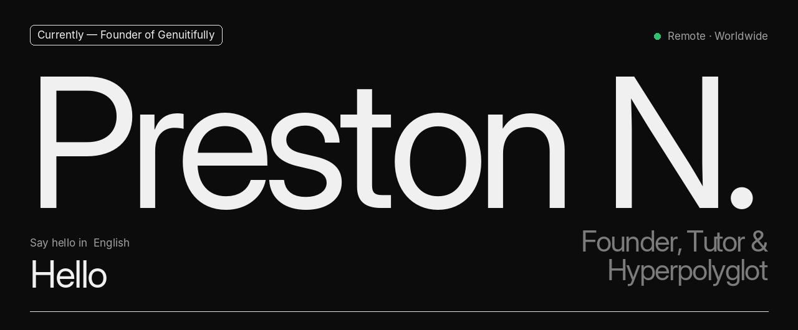
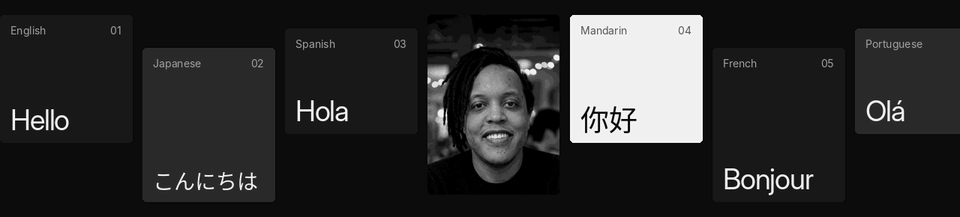
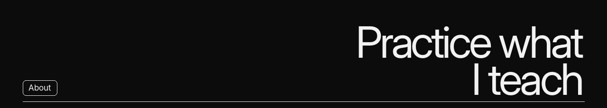
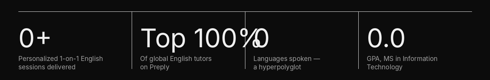
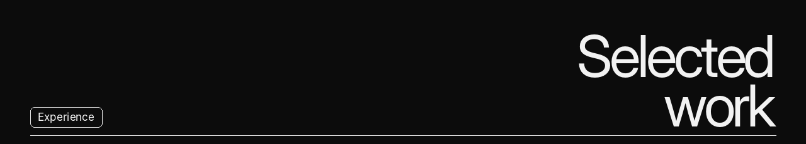
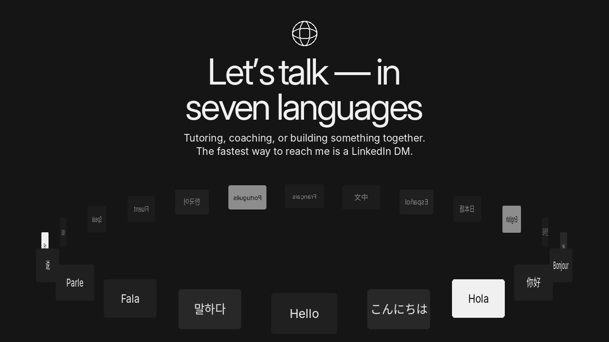
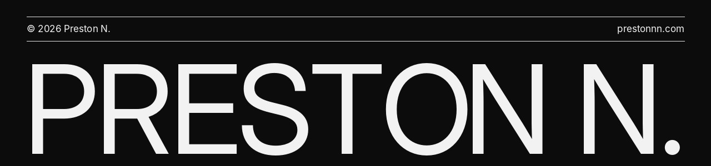

  
  
  
  
  

**More than a tutor — a builder of systems that help people reach ambitious goals in months, not years.**

I help adult learners and professionals across the Americas, Europe, Africa and Asia speak fluently and confidently, and I document frameworks that make big goals achievable in a fun‑first way.

In one year I reached conversational fluency in Spanish and French while completing a 90 lb (41 kg) weight‑loss journey. Behind it all: nearly a decade in tech and degrees in Computer Science, Mass Communication and Information Technology.

<b>Genuitifully</b> &nbsp;·&nbsp; Founder &nbsp;·&nbsp; October 2026 – Present

Building and architecting <b>Genuitifully</b>, a proprietary gamified SaaS platform designed to promote and incentivize personal and community resourcefulness.

<b>Preply</b> &nbsp;·&nbsp; English Tutor &nbsp;·&nbsp; December 2024 – Present

Delivered <b>3,000+ personalized 1‑on‑1 English sessions</b> to adult learners and professionals across the Americas, Europe, Africa, and Asia, helping them speak fluently and confidently in months rather than years.

<ul>
<li>Recognized in the <b>Top 5%</b> of global English tutors on Preply for outstanding student satisfaction, retention, and lesson completion rates.</li>
<li>Formulated customized learning plans and high‑volume immersion strategies tailored to diverse cultural backgrounds and professional goals.</li>
<li>Trained non‑native speakers to build conversational speed, master real‑world vocabulary, and overcome speaking anxiety using structured deliberate practice frameworks.</li>
</ul>

<a href="https://preply.in/PRESTON6EN23034209102?ts=17943477">View my Preply profile ↗</a>

<b>Polyfluencity</b> &nbsp;·&nbsp; Founder &amp; Transformational Life Coach &nbsp;·&nbsp; July 2026 – Present

Document and teach proven frameworks that help people accomplish ambitious goals in months, not years, in a fun‑first way — I practice what I teach and give people actionable systems to achieve anything.

<b>Tech Experience</b> &nbsp;·&nbsp; May 2015 – July 2024

Nearly a decade working in technology, grounded in a BS in Computer Science and continued through an MS in Information Technology and Kaggle certifications in machine learning and advanced SQL.

| Degree | School | Dates |
| :-- | :-- | :-- |
| **MS, Information Technology** · 4.0 / 4.0 GPA | University of the People · Pasadena, CA | Apr 2025 – Jun 2026 |
| **BS, Computer Science** | Middle Tennessee State University · Murfreesboro, TN | Aug 2015 – Dec 2018 |
| **BS, Mass Communication** | Middle Tennessee State University · Murfreesboro, TN | Aug 2007 – Dec 2012 |

| | Credential | Issuer | |
| :-- | :-- | :-- | :-- |
| 01 | **Intermediate Machine Learning** | Kaggle | [View credential ↗](https://www.kaggle.com/learn/certification/prestonnbuilds/intermediate-machine-learning) |
| 02 | **Advanced SQL** | Kaggle | [View credential ↗](https://www.kaggle.com/learn/certification/prestonnbuilds/advanced-sql) |
| 03 | **JLPT N2 · 日本語能力試験新二級** | The Japan Foundation | ID N2A156406A |

<table>
<tr>
<td valign="top" width="58%">
<b>Languages</b>
<table>
<tr><td>English</td><td>Native</td></tr>
<tr><td>Japanese</td><td>Full professional (JLPT N2)</td></tr>
<tr><td>Spanish</td><td>Professional (Duolingo Score 129)</td></tr>
<tr><td>Mandarin Chinese</td><td>Professional (Duolingo Score 129)</td></tr>
<tr><td>French</td><td>Professional (Duolingo Score 129)</td></tr>
<tr><td>Portuguese</td><td>Professional (Duolingo Score 129)</td></tr>
<tr><td>Korean</td><td>Professional (Duolingo Score 129)</td></tr>
</table>
</td>
<td valign="top">
<b>Contact</b>

Please DM me on LinkedIn for full contact information.

<b>LinkedIn</b>&nbsp; <a href="https://www.linkedin.com/in/prestonnn">linkedin.com/in/prestonnn</a> 
<b>Website</b>&nbsp; <a href="https://prestonnn.com">prestonnn.com</a> 
<b>Email</b>&nbsp; contact@prestonnn.com 
<b>GitHub</b>&nbsp; <a href="https://github.com/prestonnbuilds">github.com/prestonnbuilds</a> 
<b>Preply</b>&nbsp; <a href="https://preply.in/PRESTON6EN23034209102?ts=17943477">Book a lesson ↗</a>

</td>
</tr>
</table>

