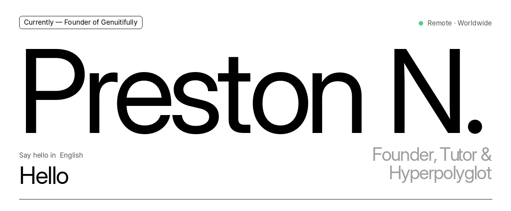
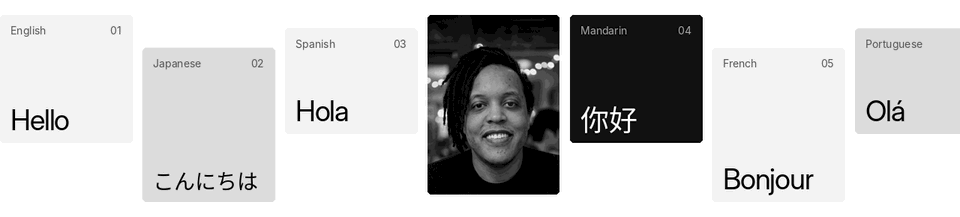
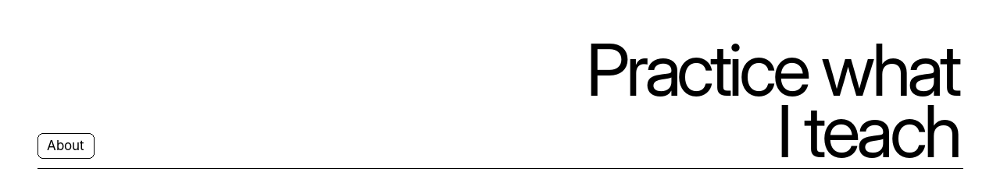
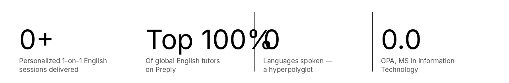
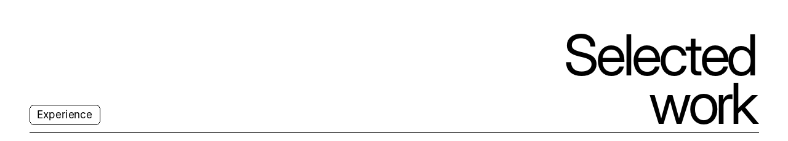
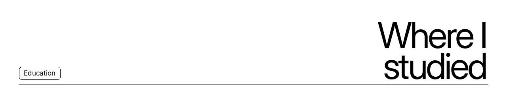
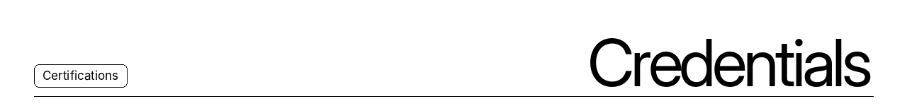
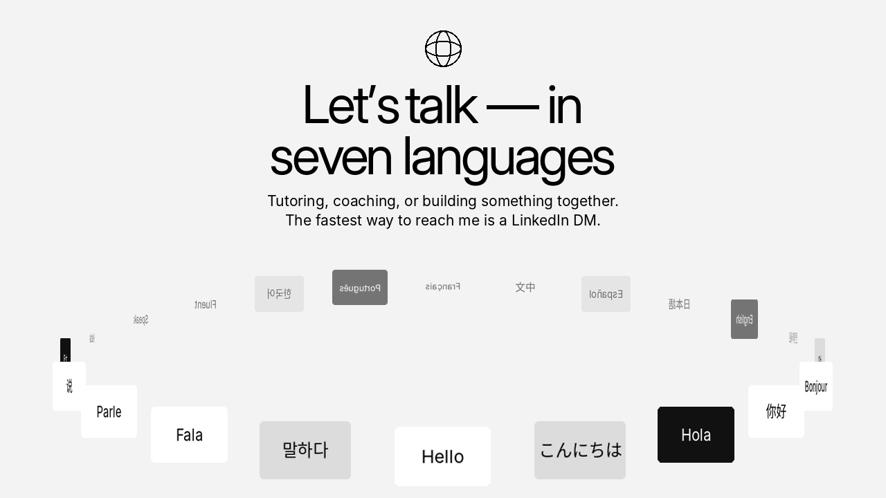
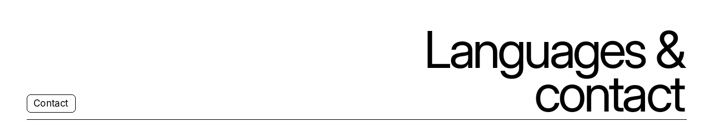
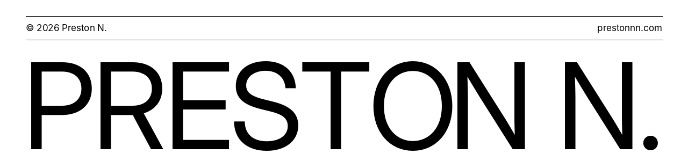

<a href="https://prestonnn.com">
  <picture>
  <source media="(prefers-color-scheme: dark)" srcset="assets/header.gif">
  <source media="(prefers-color-scheme: light)" srcset="assets/header-light.gif">
  
</picture>
</a>

<picture>
  <source media="(prefers-color-scheme: dark)" srcset="assets/strip.gif">
  <source media="(prefers-color-scheme: light)" srcset="assets/strip-light.gif">
  
</picture>

  <a href="https://www.linkedin.com/in/prestonnn"><picture>
  <source media="(prefers-color-scheme: dark)" srcset="https://img.shields.io/badge/LinkedIn-prestonnn-0c0c0c?style=flat-square&labelColor=0c0c0c&color=2b2b2b">
  <source media="(prefers-color-scheme: light)" srcset="https://img.shields.io/badge/LinkedIn-prestonnn-f3f3f3?style=flat-square&labelColor=f3f3f3&color=dcdcdc">
  
</picture></a>
  <a href="https://prestonnn.com"><picture>
  <source media="(prefers-color-scheme: dark)" srcset="https://img.shields.io/badge/Website-prestonnn.com-0c0c0c?style=flat-square&labelColor=0c0c0c&color=2b2b2b">
  <source media="(prefers-color-scheme: light)" srcset="https://img.shields.io/badge/Website-prestonnn.com-f3f3f3?style=flat-square&labelColor=f3f3f3&color=dcdcdc">
  
</picture></a>
  <a href="mailto:contact@prestonnn.com"><picture>
  <source media="(prefers-color-scheme: dark)" srcset="https://img.shields.io/badge/Email-contact%40prestonnn.com-0c0c0c?style=flat-square&labelColor=0c0c0c&color=2b2b2b">
  <source media="(prefers-color-scheme: light)" srcset="https://img.shields.io/badge/Email-contact%40prestonnn.com-f3f3f3?style=flat-square&labelColor=f3f3f3&color=dcdcdc">
  
</picture></a>
  <a href="https://github.com/prestonnbuilds"><picture>
  <source media="(prefers-color-scheme: dark)" srcset="https://img.shields.io/badge/GitHub-prestonnbuilds-0c0c0c?style=flat-square&labelColor=0c0c0c&color=2b2b2b">
  <source media="(prefers-color-scheme: light)" srcset="https://img.shields.io/badge/GitHub-prestonnbuilds-f3f3f3?style=flat-square&labelColor=f3f3f3&color=dcdcdc">
  
</picture></a>
  <a href="https://preply.in/PRESTON6EN23034209102?ts=17943477"><picture>
  <source media="(prefers-color-scheme: dark)" srcset="https://img.shields.io/badge/Preply-Top%205%25%20English%20Tutor-0c0c0c?style=flat-square&labelColor=0c0c0c&color=2fbf71">
  <source media="(prefers-color-scheme: light)" srcset="https://img.shields.io/badge/Preply-Top%205%25%20English%20Tutor-f3f3f3?style=flat-square&labelColor=f3f3f3&color=2fbf71">
  
</picture></a>

<picture>
  <source media="(prefers-color-scheme: dark)" srcset="assets/about.png">
  <source media="(prefers-color-scheme: light)" srcset="assets/about-light.png">
  
</picture>

**More than a tutor — a builder of systems that help people reach ambitious goals in months, not years.**

I help adult learners and professionals across the Americas, Europe, Africa and Asia speak fluently and confidently, and I document frameworks that make big goals achievable in a fun‑first way.

In one year I reached conversational fluency in Spanish and French while completing a 90 lb (41 kg) weight‑loss journey. Behind it all: nearly a decade in tech and degrees in Computer Science, Mass Communication and Information Technology.

<picture>
  <source media="(prefers-color-scheme: dark)" srcset="assets/stats.gif">
  <source media="(prefers-color-scheme: light)" srcset="assets/stats-light.gif">
  
</picture>

<picture>
  <source media="(prefers-color-scheme: dark)" srcset="assets/work.png">
  <source media="(prefers-color-scheme: light)" srcset="assets/work-light.png">
  
</picture>

<b>Genuitifully</b> &nbsp;·&nbsp; Founder &nbsp;·&nbsp; October 2026 – Present

I founded Genuitifully on a simple belief: poverty won’t be solved by encouraging everyone to become a millionaire. It will be solved by building an economy where ordinary work supports a decent life.

Genuitifully is a gamified platform that helps people and communities build economic resilience, so they can prepare for downturns, recover faster, and choose steady, shared growth over boom-and-bust.

As founder, my roadmap to lead the company end to end is as follows:

<ul>
<li><b>Product:</b> Build our first app, a savings game that makes budgeting feel like beating your high score.</li>
<li><b>Brand:</b> Direct the company’s visual identity, including the logo system, color palette, typography, and social media assets.</li>
<li><b>Messaging:</b> Write the company’s mission, positioning, and slogan, “Ingenuity, played beautifully.”</li>
<li><b>Global reach:</b> Launch a multilingual website in eight languages, drawing on my own background as a speaker of seven languages.</li>
<li><b>Partnerships:</b> Build a community of early testers, partners, and press who share the mission.</li>
</ul>

A better economy isn’t something we wait for. It’s something we practice, together.

<b>Preply</b> &nbsp;·&nbsp; English Tutor &nbsp;·&nbsp; December 2024 – Present

Delivered <b>3,000+ personalized 1‑on‑1 English sessions</b> to adult learners and professionals across the Americas, Europe, Africa, and Asia, helping them speak fluently and confidently in months rather than years.

<ul>
<li>Recognized in the <b>Top 5%</b> of global English tutors on Preply for outstanding student satisfaction, retention, and lesson completion rates.</li>
<li>Formulated customized learning plans and high‑volume immersion strategies tailored to diverse cultural backgrounds and professional goals.</li>
<li>Trained non‑native speakers to build conversational speed, master real‑world vocabulary, and overcome speaking anxiety using structured deliberate practice frameworks.</li>
</ul>

<a href="https://preply.in/PRESTON6EN23034209102?ts=17943477">View my Preply profile ↗</a>

<b>Polyfluencity</b> &nbsp;·&nbsp; Founder &amp; Transformational Life Coach &nbsp;·&nbsp; July 2026 – Present

I founded Polyfluencity to help people close the gap between who they are and who they want to become. I use structured goal frameworks to turn big ambitions into steady, measurable progress.

As Founder, I set the vision, build the coaching method, and run the business end to end. As a Transformational Life Coach, I work one-on-one with clients to clarify what they want, find what’s holding them back, and build habits that last.

<b>What I do:</b>

<ul>
<li>Design and refine Polyfluencity’s own goal-setting and accountability frameworks, which turn long-term vision into concrete action plans</li>
<li>Lead one-on-one coaching sessions on personal growth, mindset, career direction, and life transitions</li>
<li>Help clients spot limiting beliefs and replace them with practical, sustainable routines</li>
<li>Coach across languages and cultures, drawing on fluency in seven languages (English, Japanese, Spanish, Mandarin, French, Portuguese and Korean)</li>
<li>Build the brand, client programs and content strategy from the ground up</li>
<li>Apply my 9 years in tech to use systems thinking and simple tools that keep clients’ progress visible and on track</li>
</ul>

<b>My approach:</b>

Real transformation is part mindset and part method. I pair empathetic, client-centered coaching with clear structure, so clients feel supported and also see results.

<b>Tech Experience</b> &nbsp;·&nbsp; May 2015 – July 2024

Nearly a decade working in technology, grounded in a BS in Computer Science and continued through an MS in Information Technology and Kaggle certifications in machine learning and advanced SQL.

<picture>
  <source media="(prefers-color-scheme: dark)" srcset="assets/education.png">
  <source media="(prefers-color-scheme: light)" srcset="assets/education-light.png">
  
</picture>

| Degree | School | Dates |
| :-- | :-- | :-- |
| **MS, Information Technology** · 4.0 / 4.0 GPA | University of the People · Pasadena, CA | Apr 2025 – Jun 2026 |
| **BS, Computer Science** | Middle Tennessee State University · Murfreesboro, TN | Aug 2015 – Dec 2018 |
| **BS, Mass Communication** | Middle Tennessee State University · Murfreesboro, TN | Aug 2007 – Dec 2012 |

<picture>
  <source media="(prefers-color-scheme: dark)" srcset="assets/credentials.png">
  <source media="(prefers-color-scheme: light)" srcset="assets/credentials-light.png">
  
</picture>

| | Credential | Issuer | |
| :-- | :-- | :-- | :-- |
| 01 | **Intermediate Machine Learning** | Kaggle | [View credential ↗](https://www.kaggle.com/learn/certification/prestonnbuilds/intermediate-machine-learning) |
| 02 | **Advanced SQL** | Kaggle | [View credential ↗](https://www.kaggle.com/learn/certification/prestonnbuilds/advanced-sql) |
| 03 | **JLPT N2 · 日本語能力試験新二級** | The Japan Foundation | ID N2A156406A |

<a href="https://www.linkedin.com/in/prestonnn">
  <picture>
  <source media="(prefers-color-scheme: dark)" srcset="assets/cta.gif">
  <source media="(prefers-color-scheme: light)" srcset="assets/cta-light.gif">
  
</picture>
</a>

<picture>
  <source media="(prefers-color-scheme: dark)" srcset="assets/contact.png">
  <source media="(prefers-color-scheme: light)" srcset="assets/contact-light.png">
  
</picture>

<table>
<tr>
<td valign="top" width="58%">
<b>Languages</b>
<table>
<tr><td>English</td><td>Native</td></tr>
<tr><td>Japanese</td><td>Full professional (JLPT N2)</td></tr>
<tr><td>Spanish</td><td>Professional (Duolingo Score 129)</td></tr>
<tr><td>Mandarin Chinese</td><td>Professional (Duolingo Score 129)</td></tr>
<tr><td>French</td><td>Professional (Duolingo Score 129)</td></tr>
<tr><td>Portuguese</td><td>Professional (Duolingo Score 129)</td></tr>
<tr><td>Korean</td><td>Professional (Duolingo Score 129)</td></tr>
</table>
</td>
<td valign="top">
<b>Contact</b>

Please DM me on LinkedIn for full contact information.

<b>LinkedIn</b>&nbsp; <a href="https://www.linkedin.com/in/prestonnn">linkedin.com/in/prestonnn</a> 
<b>Website</b>&nbsp; <a href="https://prestonnn.com">prestonnn.com</a> 
<b>Email</b>&nbsp; contact@prestonnn.com 
<b>GitHub</b>&nbsp; <a href="https://github.com/prestonnbuilds">github.com/prestonnbuilds</a> 
<b>Preply</b>&nbsp; <a href="https://preply.in/PRESTON6EN23034209102?ts=17943477">Book a lesson ↗</a>

</td>
</tr>
</table>

<picture>
  <source media="(prefers-color-scheme: dark)" srcset="assets/footer.png">
  <source media="(prefers-color-scheme: light)" srcset="assets/footer-light.png">
  
</picture>
